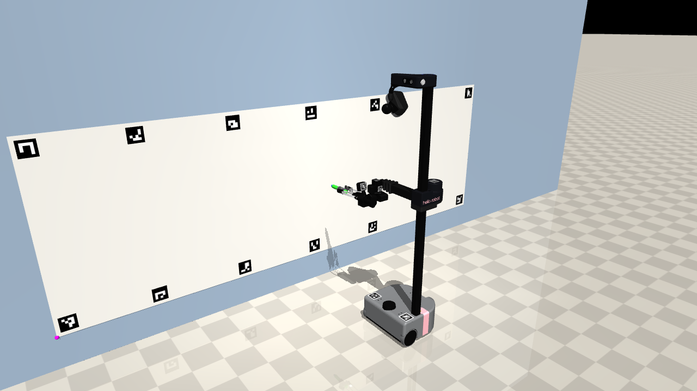
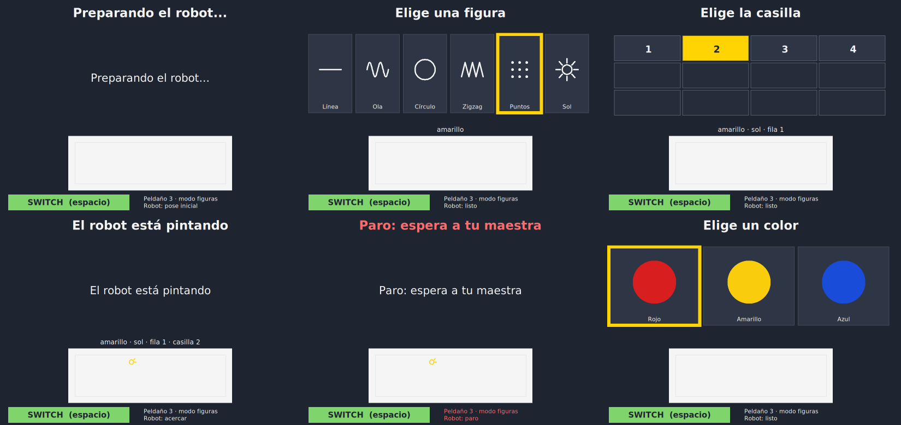
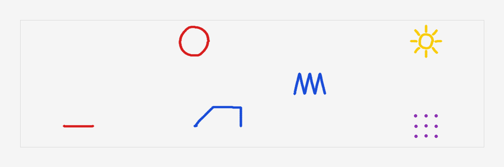
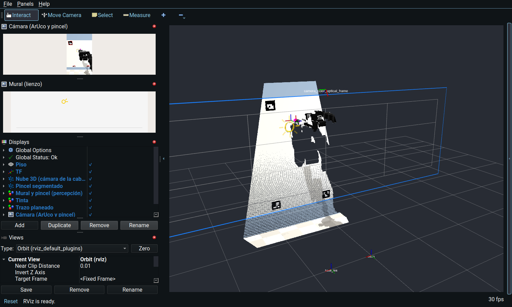

# INA_Strech_WS: Pequeños Muralistas (ROS 2 Humble)

El Stretch 3 pinta un mural mientras un niño con PC lo dirige con su switch. Funciona en simulación (MuJoCo) con el modelo oficial de `hello-robot/stretch_mujoco`.



## Clonar en otra máquina

`build/`, `install/`, `log/`, `.venv/` y `datos/` no van en el repo. El modelo del Stretch viene como submódulo.

```bash
git clone --recurse-submodules https://github.com/GorgeLop07/INA_Strech_WS.git
cd INA_Strech_WS
python3 -m venv --system-site-packages .venv
.venv/bin/pip install 'mujoco==3.2.6' 'numpy<2' 'opencv-python-headless==4.10.0.84'
source entorno.sh && mbuild
```

## Cómo correrlo

```bash
cd ICORR/INA_Strech_WS
source entorno.sh      # ROS 2 + .venv (MuJoCo, numpy<2, OpenCV 4.10) + lo compilado
mbuild                 # compila; después: source entorno.sh
ros2 launch muralistas_bringup sim_mural.launch.py                # figuras, peldaño 3
ros2 launch muralistas_bringup sim_mural.launch.py modo:=libre    # trazo libre
ros2 launch muralistas_bringup sim_mural.launch.py nivel:=1 viewer:=false
ros2 launch muralistas_bringup sim_mural.launch.py board_frame:=board_gt auto_startup:=false   # sin percepción (más rápido)
```

**Ventanas que se abren:**
- **MuJoCo:** el robot y el mural.
- **RViz:** la nube 3D, el mural detectado, el pincel segmentado y la tinta.
- **Pantalla del niño:** los pictogramas del barrido.

**Al arrancar (~40 s)** el robot:
1. se pone en su pose inicial;
2. barre con la cabeza para ubicar el mural con los ArUco;
3. calibra la punta del pincel con la nube 3D;
4. queda "listo".

El menú no empieza a barrer hasta que el robot está listo.

**Teclas de la pantalla:**
- **espacio**: switch (también se puede usar el botón con el mouse)
- **a**: elige el adulto (queda registrado como "adulto")
- **p** o **Esc**: PARO
- **r**: reanudar
- **n**: segundo switch (barrido por pasos)

Cada sesión guarda un CSV en `datos/` con cada decisión, su fuente (niño, adulto o automática) y su tiempo de respuesta. Con eso se calcula el **% de decisiones propias**.

## Paquetes

| Paquete | Qué hace |
|---|---|
| `muralistas_interfaces` | Mensajes, servicios y acciones (`StrokeRequest`, `ScanState`, `Board`, `Decision`, `DrawStroke`, `CalibrateTool`, `SetBrushColor`) |
| `muralistas_common` | Geometría del mural, figuras, colores y transformaciones (sin ROS) |
| `muralistas_sim` | MuJoCo: Stretch 3, pared, papel con 14 ArUco, pincel con resorte en la pinza y tinta. Expone las mismas interfaces que el driver real (`/stretch_controller/follow_joint_trajectory`, `/camera/...`, `/joint_states`, `/tf`) |
| `muralistas_perception` | Nube 3D de la cabeza; pose del mural (esquinas de ArUco en 3D + plano); segmentación del pincel y calibración de la punta |
| `muralistas_planning` | Figura + casilla, o dirección libre → trazos en coordenadas del mural |
| `muralistas_control` | Trazos → base + elevador + brazo (el Stretch es casi cartesiano); acercar, apoyar, pintar y levantar; paro; rutina de arranque |
| `muralistas_hri` | Filtro del switch (tiempo de aceptación y retardo), menú de barrido por peldaños, pantalla de pictogramas y registro de decisiones |
| `muralistas_bringup` | Launch, `config/` (mural, simulación, control, percepción), `config/perfiles/` (uno por niño) y RViz |

**Flujo:** switch → `hri` → `planning` → `control` → simulador (o el driver del robot real). La percepción le da a la planeación y al control la pose del mural y la punta calibrada.

## Cómo indica el niño lo que quiere

El niño no hace gestos: su único "sí" es el switch que ya usa. La pantalla ilumina las opciones una por una y el niño presiona cuando se ilumina la que quiere.

- **Figuras (peldaños 1 a 4):**
  1. Una presión pinta.
  2. Elige el color.
  3. Elige color, figura, fila y casilla.
  4. Lo mismo, pero copiando un diseño.
- **Trazo libre:**
  1. Elige color y casilla; ahí se apoya el pincel.
  2. Una flecha gira por 8 direcciones.
  3. Al presionar, el robot pinta en esa dirección hasta que el niño vuelve a presionar, o hasta que suelta si su perfil es "mantener". Cada tramo mide como máximo 0.6 m.
  4. "Levantar" termina el trazo.



## Resultados en simulación (13-nov-2026)

| Qué | Resultado |
|---|---|
| Pose del mural contra la verdad | 1.7 a 3.4 mm y ≤ 0.05° (3 marcadores, 12 esquinas, con el barrido de cabeza) |
| Punta del pincel calibrada | 2.3 mm de error (sin calibrar: 14 mm, por el error de agarre puesto a propósito) |
| Error del trazo contra lo planeado | Medio 1.2 a 2.1 mm, máximo 4 mm (línea, círculo, zigzag, sol, puntos) |
| Tiempo por figura | Línea 21 s, círculo 24 s, zigzag 26 s, puntos 46 s, sol 64 s (9 trazos) |
| Interacción completa con switch | Figuras y trazo libre, del switch crudo a la tinta, con registro de decisiones |
| Paro | Detiene el trazo, bloquea el menú e ignora el switch; al liberar vuelve a empezar |
| Velocidad de la simulación | ~1.0× tiempo real con todo el sistema |
| Cierre con Ctrl+C | Los 9 procesos terminan limpio |
| Pruebas unitarias | 18 pasan |

```bash
PYTHONPATH=src/muralistas_common:src/muralistas_hri:src/muralistas_control:src/muralistas_planning:$PYTHONPATH python -m pytest -q src/*/test
```





## Decisiones de la simulación (para no tropezar de nuevo)

- **El lidar está apagado** (`physics.lidar: false`). Son 360 rayos contra mallas de cientos de miles de vértices y costaban 28 veces más que el resto de la física.
- **Las imágenes se arman con `array.array('B', ...)`.** Asignar `bytes` a `Image.data` en Humble valida byte por byte (~50 ms por imagen).
- **El papel es solo visual** y la punta toca la pared. Con el papel como caja de colisión, la punta quedaba atrapada entre dos cajas (~60 N en vez de ~2 N).
- **El elevador y el brazo simulados llevan un lazo** de prealimentación de velocidad más integral, que imita a los motores reales. Los actuadores del MJCF son solo proporcionales: sin ese lazo quedaban ~5 mm de error estable y ~1.7 cm de retraso.
- **Los argumentos del launch van en un YAML con el nombre del nodo.** Un diccionario se pasa como `/**`, y ese pierde contra lo que el perfil pone con el nombre del nodo.

## Pendiente

- **En el robot real hay que confirmar:**
  - el nombre de la articulación de la base en modo trajectory (`joints.base`);
  - el marco `link_grasp_center` y el offset de la punta;
  - poner `color_service: ""`.
- **Optimizar la tinta en la cámara.** Dibujar la tinta en la imagen de la cámara ya ocupa ~45% del ciclo cuando hay mucha tinta; si el mural se llena, conviene optimizarlo.
- **E4 (paro por persona):** se puede simular activando el lidar a baja frecuencia.
